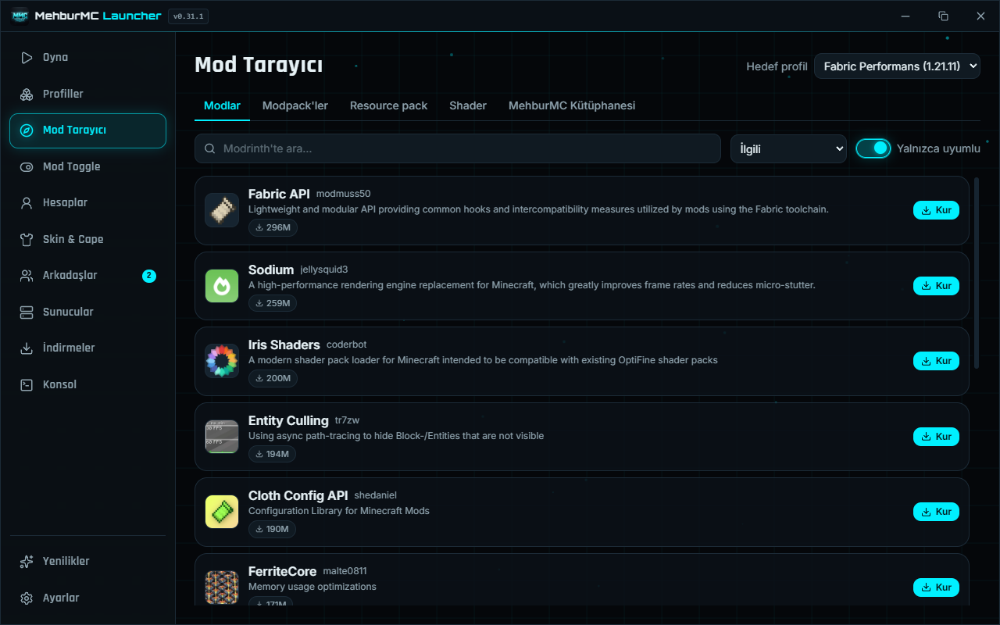
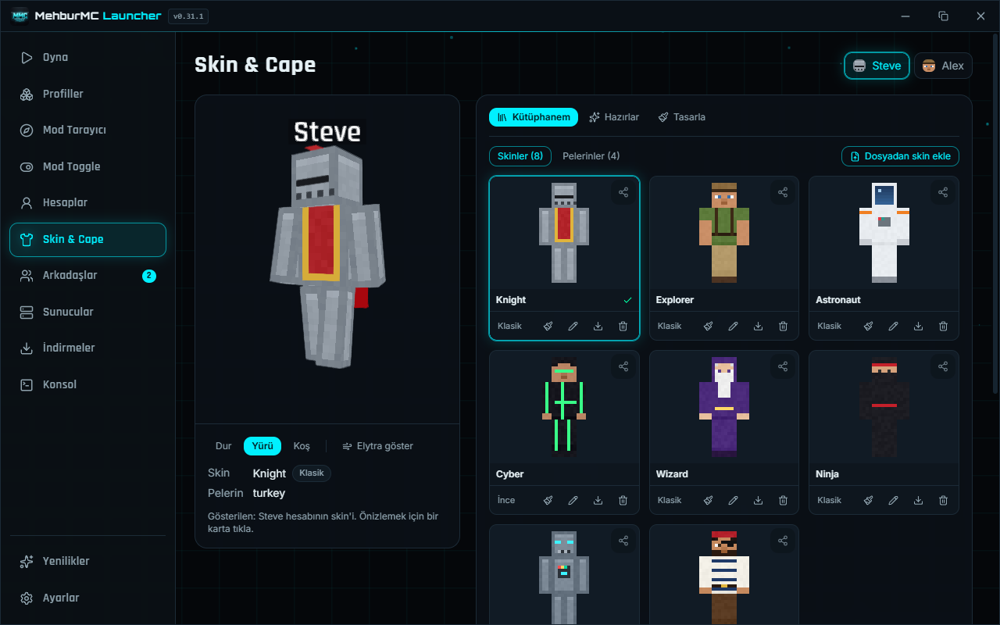
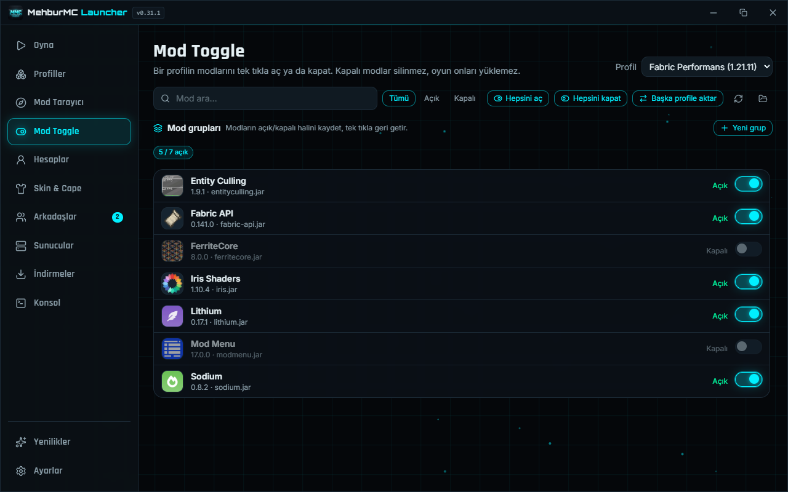
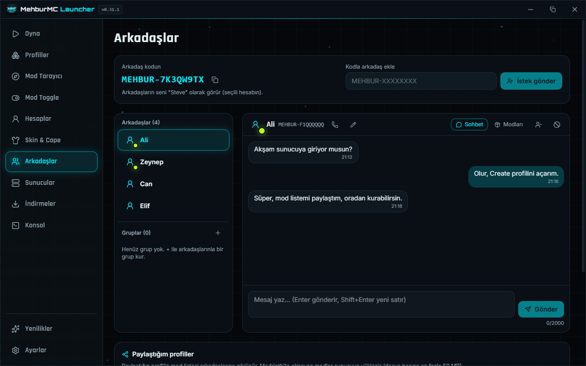

# MehburMC Launcher

[](https://github.com/Mehbur07/MehburMC-Launcher/actions/workflows/ci.yml)
[](https://github.com/Mehbur07/MehburMC-Launcher/releases/latest)
[](LICENSE)

Windows ve Linux için hafif, reklamsız ve telemetrisiz bir Minecraft Java Edition launcher'ı.
Modları, skinleri ve arkadaşlarını tek yerden yönet.

_[English below](#english)_



| Skin & Cape                              | Mod Toggle                                   | Arkadaşlar                                 |
| ---------------------------------------- | -------------------------------------------- | ------------------------------------------ |
|  |  |  |

<sub>Ekran görüntülerindeki hesaplar, arkadaşlar ve mesajlar örnek verilerdir.</sub>

## ⬇️ İndir

**[En son sürümü indir (Releases)](https://github.com/Mehbur07/MehburMC-Launcher/releases/latest)**

- **Windows:** sayfadaki **`MehburMC-Launcher_<sürüm>_x64-setup.exe`** dosyasını indirip çalıştır.
- **Linux (Ubuntu 26.04 / MehburOS):** `-linux` ile biten sürümdeki `.deb` paketini indir, sonra
  `sudo apt install ./MehburMC-Launcher_<sürüm>_amd64.deb` komutunu çalıştır.

"Source code" dosyaları launcher değildir, kaynak koddur; oynamak için gerekmez. Launcher kendini
güncel tutar: yeni sürüm çıkınca başlık çubuğunda **Güncelle** butonu belirir.

## Özellikler

- **Profiller:** Vanilla, Fabric, Quilt, Legacy Fabric, Forge, NeoForge ve OptiFine; her profilin
  kendi `mods`, `saves` ve `config` klasörü var. Otomatik Java (Adoptium Temurin) yönetimi.
- **Mod Tarayıcı:** Modrinth'te mod, modpack, resource pack ve shader arama ve kurma, güncellemeleri
  görme, `.mrpack` içe aktarma.
- **Mod Toggle:** modları tek tıkla açıp kapatma, mod grupları ve bir profilin bütün modlarını başka
  bir profile aktarma (farklı sürüme aktarırken uygun sürümü Modrinth'ten bulur).
- **Skin & Cape:** skin ve pelerin kütüphanesi, hazır koleksiyonlar, 3B önizlemeli piksel editörü,
  toplulukla paylaşma.
- **Arkadaşlar:** arkadaş koduyla ekleme, mesajlaşma, grup sohbetleri, sesli arama (16 kişiye kadar),
  ekran paylaşma ve mod listesi paylaşma.
- **MehburMC Kütüphanesi:** oyuncuların yüklediği modlar ve paketler; dosyalar otomatik taranır ve
  yönetici onayından sonra yayınlanır.
- **Sunucular:** favori sunucular, ping ve oyuncu sayısı, tek tıkla katılma.
- Minecraft haberleri, çökme analizi, istediğin renkte tema, TR/EN arayüz, portable mod.
- Giriş: MehburMC hesabı (e-posta ya da Google) veya yalnızca bu bilgisayarda kalan yerel hesap.
  Oyunda offline hesaplar kullanılır; Microsoft girişi yoktur.

Ayrıntılar: [kullanım kılavuzu](docs/KULLANIM.md) · [sorun giderme](docs/SORUN_GIDERME.md) ·
[gizlilik](docs/GIZLILIK.md) · [geliştirici rehberi](docs/GELISTIRME.md) ·
[mimari ve kararlar](ARCHITECTURE.md) · [güvenlik](SECURITY.md) · [değişiklik günlüğü](CHANGELOG.md)

## English

MehburMC Launcher is a lightweight Minecraft: Java Edition launcher for Windows and Linux, with no
ads and no telemetry. It is built with Tauri 2 (Rust) and React + TypeScript. The interface is
available in Turkish and English (Settings → Language).

- **Profiles:** Vanilla, Fabric, Quilt, Legacy Fabric, Forge, NeoForge and OptiFine, each with its
  own folders. Java (Adoptium Temurin) is installed automatically.
- **Mods:** browse and install mods, modpacks, resource packs and shaders from Modrinth, toggle mods
  on and off, save mod groups, and send all mods of a profile to another one, even across Minecraft
  versions.
- **Skins:** skin and cape library, built-in collections and a pixel editor with a live 3D preview.
- **Friends:** friend codes, chat, group chats, voice calls for up to 16 people, screen sharing and
  shared mod lists.
- **Servers, news, crash analysis, custom theme color, portable mode and self-updating.**

**Download:** get `MehburMC-Launcher_<version>_x64-setup.exe` from the
[latest release](https://github.com/Mehbur07/MehburMC-Launcher/releases/latest), or the `.deb` from
the matching `-linux` release (Ubuntu 26.04). The game itself is downloaded from Mojang's official
servers. Microsoft sign-in is not supported; the game runs with offline accounts.

**Build from source:** see [Development](#geliştirme-gereksinimleri) below (commands are the same in
any language). Licensed under [GPL-3.0](LICENSE).

## Geliştirme gereksinimleri

- Rust (stable, `rustup`), MSVC Build Tools (C++ iş yükü)
- Node.js 20+
- WebView2 (Windows 11'de hazır gelir)

```sh
npm install
npm run tauri dev          # uygulamayı geliştirme modunda aç
cargo test --workspace     # Rust testleri (+ src/lib/ipc/bindings TS tiplerini üretir)
cargo clippy --workspace --all-targets -- -D warnings
npm test                   # Vitest
npm run coverage           # frontend kapsamı (Rust: cargo llvm-cov)
npm run lint               # ESLint
cargo run -p launcher-cli -- paths   # çekirdeği UI olmadan dene
npm run package            # imzalı NSIS kurulum + portable zip (aşağıya bakın)
npm run package:linux      # Linux .deb (Docker gerekir)
```

Her push'ta GitHub Actions biçim, Clippy, Rust ve frontend testlerini çalıştırır
([CI](.github/workflows/ci.yml)).

### Paketleme ve yayın

`npm run package` → `target/release/bundle/nsis/*-setup.exe` (+ updater için `.sig`) ve
`target/release/bundle/portable/*-portable.zip`. Updater imzası için ortam değişkenleri gerekir:

```powershell
$env:TAURI_SIGNING_PRIVATE_KEY = Get-Content -Raw "$HOME\.tauri\mehburmc-updater.key"
$env:TAURI_SIGNING_PRIVATE_KEY_PASSWORD = Get-Content -Raw "$HOME\.tauri\mehburmc-updater.password"
npm run package
```

Yayınlamak için `node scripts/publish-release.mjs`: GitHub sürümüne yalnızca kurulum `.exe`'sini
koyar, `.deb` varsa ayrı bir `-linux` ön sürümüne yükler, güncelleme bilgisini (`latest.json`)
`updater` dalına yazar.

### Çekirdek CLI (`mehbur-cli`)

```sh
cargo run -p launcher-cli -- versions --type release --limit 10
cargo run -p launcher-cli -- java list
cargo run -p launcher-cli -- java install 21
cargo run -p launcher-cli -- launch 26.3 --offline Steve            # indir + başlat
cargo run -p launcher-cli -- launch 1.12.2 --offline Steve --dry-run  # yalnızca komut satırı
cargo run -p launcher-cli -- launch 26.3 --offline Steve --exit-when-ready 10  # test: ana menüde kapat
cargo run -p launcher-cli -- launch 26.3 --offline Steve --verify    # tüm dosyaları SHA-1 ile onar
cargo run -p launcher-cli -- loader list forge 1.20.1                 # loader sürümleri
cargo run -p launcher-cli -- launch 1.20.1 --loader forge --exit-when-ready 5
cargo run -p launcher-cli -- launch 26.3 --loader fabric:0.19.5      # belirli loader sürümü
cargo run -p launcher-cli -- loader import-optifine OptiFine_1.20.1_HD_U_I6.jar
cargo run -p launcher-cli -- launch 1.20.1 --loader optifine
cargo run -p launcher-cli -- content search sodium --mc 1.20.1 --loader fabric
cargo run -p launcher-cli -- modpack import paket.mrpack           # yeni profil
cargo run -p launcher-cli -- content scan <profil-id> --updates
```

Veri klasörü: `%APPDATA%\MehburMC\game\mc\`. Exe'nin yanına boş bir `portable.flag` dosyası koyarsanız veri exe klasöründeki `MehburMC\game\mc\` altında tutulur.

## Lisans

MehburMC Launcher, [GNU General Public License v3.0](LICENSE) ile lisanslıdır. Kodu kullanabilir,
değiştirebilir ve dağıtabilirsin; değiştirdiğin bir sürümü dağıtırsan onun kaynak kodunu da aynı
lisansla açman gerekir.

## Yasal

MehburMC Launcher, Mojang Studios veya Microsoft ile bağlantılı değildir. Oyun dosyaları yalnızca resmî kaynaklardan indirilir; launcher hiçbir telifli varlık dağıtmaz.
